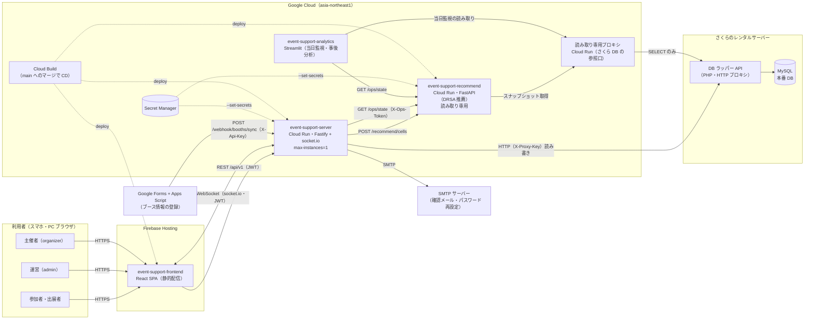
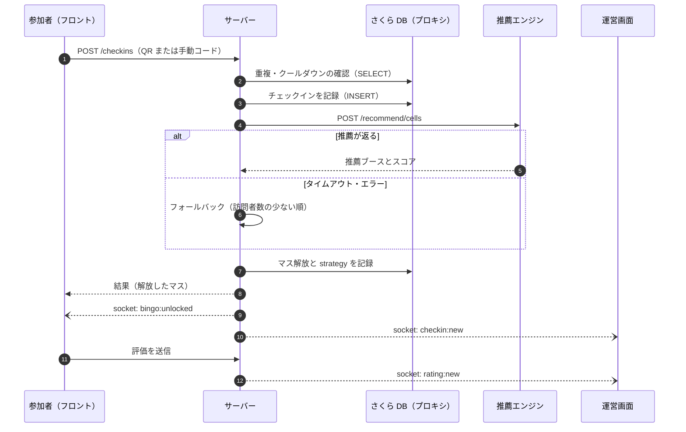
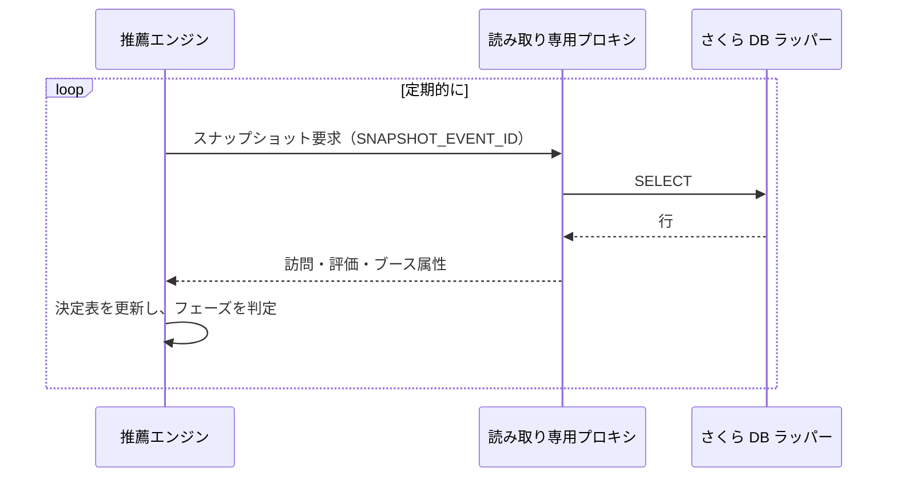
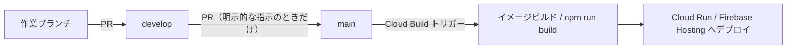

> **現状の事実を記録する文書。** v1（2026-10-16 本番）時点のシステム構成。
> URL・キー・トークン・イベント ID などの**値は書かない。** 変数名と置き場所だけを書く。
> 値の確認は Cloud Run / Secret Manager / Cloud Build トリガーのコンソールで行う。

# システム構成

## 1. 全体図

| コンポーネント | リポジトリ | 実行環境 | 役割 |
|---|---|---|---|
| フロントエンド | `event-support-frontend` | Firebase Hosting | 参加者・出展者・運営・主催者の全画面。計算はせずサーバーの値を表示する |
| サーバー | `event-support-server`（本リポジトリ） | Cloud Run | REST API・WebSocket・認証・ビンゴ/ガチャ/投票の業務ロジック。**仕様の正本** |
| 推薦エンジン | `event-support-recommend` | Cloud Run | ビンゴのマス解放で薦めるブースを決める（DRSA）。**DB へは書かない** |
| 読み取り専用プロキシ | （さくら側は無改変。GCP 上のラッパー） | Cloud Run | 推薦と分析に SELECT だけを許す参照口 |
| 分析 | `event-support-analytics` | ローカル / Cloud Run（Streamlit） | 当日の信号機監視と事後分析 |
| 本番 DB | — | さくら（MySQL + PHP ラッパー API） | 唯一の書き込み先。2026-10-08 に Cloud SQL から切り戻し（[ADR 0008](../decisions/adrs/0008-move-production-db-to-cloud-sql.md)） |
| ブース登録 | — | Google Forms + Apps Script | 出展者のフォーム回答をサーバーの Webhook へ送る |

---

## 2. 各コンポーネントの詳細

### 2.1 フロントエンド（Firebase Hosting）

- React 19 + TypeScript + Vite + Zustand + axios + Bootstrap/SCSS
- `npm run build` の成果物（`dist/`）を Firebase Hosting で静的に配信する。SPA なので全パスを `index.html` に書き換える
- `/assets/**` は1年キャッシュ（ファイル名にハッシュ付き）。`index.html` には明示的な指定がないため、デプロイ直後は旧バンドルが残ることがある
- **ビルド時に値が焼き込まれる**（`VITE_*`）。主なもの:
  - `VITE_API_BASE_URL`: サーバーの URL
  - `VITE_DEV_EVENT_ID`: 運営ログインの event_id。名前に反して本番でも必須。イベントを作り直したら再ビルドする
  - `VITE_APP_COMMIT`: ビルド元のコミット。`<meta name="app-commit">` に出る
- 本番ビルドは `productionEnvGuard` が不正な設定（サンプルデータ・モック認証・開発用ログイン情報）を検出して止める
- 推薦エンジンを直接呼ばない（必ずサーバー経由）

### 2.2 サーバー（Cloud Run）

- Fastify + socket.io + TypeScript。`Dockerfile` からビルドしたイメージを Artifact Registry に置く
- Cloud Run の設定（`cloudbuild.yaml`）:

| 設定 | 値 | 理由 |
|---|---|---|
| `max-instances` | 1 | socket.io のルームがインメモリのため（[ADR 0002](../decisions/adrs/0002-cloud-run-single-instance-for-websocket.md)） |
| `min-instances` | 0（当日だけ 1 に上げる） | コスト。コールドスタートを避けたい日だけ引き上げる |
| `concurrency` | 1000 | 1インスタンス固定の分、同時処理数を引き上げる |
| `timeout` | 3600 秒 | WebSocket の長時間接続のため |
| `session-affinity` | 有効 | socket.io のポーリングを同じインスタンスに寄せる |

- 環境変数は `--set-env-vars`（**全置換**）、秘匿値は `--set-secrets` で Secret Manager から渡す。一覧は [environment-variables.md](environment-variables.md)
- `GET /health` で `commit`（`APP_COMMIT`）と `revision`（`K_REVISION`）が分かる

主なルートの構成（詳細は [api-endpoints.md](api-endpoints.md)）:

| 系統 | パス | 利用者 | 認証 |
|---|---|---|---|
| 参加者 | `/api/v1/auth`・`/me`・`/events/...`・`/booths`・`/checkins`・`/bingo`・`/gacha`・`/awards` | 参加者・出展者 | 参加者 JWT |
| 出展者 | `/api/v1/events/:event_id/exhibitor/...` | 出展者ロールの参加者 | 参加者 JWT |
| 運営 | `/api/v1/admin/...` | 運営スタッフ | 運営 JWT（`event_id` 付き） |
| 主催者 | `/api/v1/organizer/...` | 主催者 | 主催者 JWT（`event_id` 無し） |
| 連携 | `/api/v1/webhook/booths/sync` | Apps Script | `X-Api-Key` |
| 監視 | `/health` | — | なし |

### 2.3 本番 DB（さくら）

- MySQL をさくらのレンタルサーバー上に置き、**PHP の HTTP ラッパー API 経由**でアクセスする（サーバーから MySQL へ直接は繋がない）
- サーバー側の実装は `src/db/http-proxy.ts`。`SAKURA_PROXY_URL` があると `DATABASE_URL`（ローカルの MySQL）より優先される
- 制約（実装で吸収している）:
  - DB エラーがすべて 500 に見える → INSERT の前に SELECT で重複を確認する（[ADR 0001](../decisions/adrs/0001-sakura-proxy-error-masking.md)）
  - 数値も文字列で返る → `src/db/type-coerce.ts` で数値に戻す
  - DB 既定値で入る時刻列は JST、アプリが書く時刻列は UTC
  - 非常に高い負荷（毎分 430 件超）では周期的に 500/502 を返す。想定負荷では問題ない
- スキーマは `db/create-tables.sql` と `db/migrations/`。本番への適用手順は [production-db-apply.md](../operations/production-db-apply.md)

### 2.4 推薦エンジン（Cloud Run）

- Python + FastAPI。DRSA（優越関係に基づくラフ集合）で、参加者が自分では選ばなかったであろうブースを薦める
- サーバーからの呼び出し:
  - `POST /recommend/cells`: マス解放時の推薦。タイムアウト（`RECOMMENDER_TIMEOUT_MS`）を超えるか失敗すると、サーバーは**フォールバック**（訪問者数の少ない順）で解放を続ける。ビンゴの解放は推薦の障害で止めない（[05-recommender/fallback.md](../specs/bingo-dynamic-unlock/05-recommender/fallback.md)）
  - `GET /ops/state`: 運営ダッシュボードの推薦状態表示（`X-Ops-Token`）
- 決定表は読み取り専用プロキシから定期的にスナップショットを取って作る。プロキシに繋がらないと一日中ランダム（`phase=COVERAGE`）になる
- 対象イベントは `SNAPSHOT_EVENT_ID` で指定する。本番イベントを作り直したら変更が必要
- 契約の正本は本リポジトリの [05-recommender/contract.md](../specs/bingo-dynamic-unlock/05-recommender/contract.md)

### 2.5 読み取り専用プロキシ（Cloud Run）

- さくら側には手を加えず、GCP 上に置いた参照専用の口。推薦エンジンと分析が使う
- 書き込みを構造的にさせないことで、推薦・分析の不具合が本番データを壊さないようにしている
- 再起動直後はスナップショットが未取得なのが正常

### 2.6 分析（Streamlit）

- 当日監視（信号機）と事後分析の画面。DB（読み取り専用プロキシ経由）を主な情報源にし、`/ops/state` は補助として使う
- 推薦エンジンが落ちていても監視が止まらない構成にしている
- 指標の定義は `event-support-analytics` が正本

### 2.7 外部サービス

| サービス | 用途 | サーバー側の設定 |
|---|---|---|
| Google Forms + Apps Script | ブース情報の登録・更新を Webhook で同期する | `WEBHOOK_API_KEY` |
| SMTP | メールアドレス確認・パスワード再設定のメール | `SMTP_HOST` ほか。本番で未設定なら起動しない |

---

## 3. 主要な処理の流れ

### 3.1 チェックインとマス解放

### 3.2 WebSocket のルーム

接続時に JWT を検証し、以下のルームに入れる（`src/plugins/socket.ts`）。

| ルーム | 入る人 | 主なイベント |
|---|---|---|
| `event:<event_id>` | そのイベントの全員 | — |
| `event:<event_id>:user:<user_id>` | 本人 | `bingo:unlocked` |
| `event:<event_id>:admin` | 運営 | `checkin:new`・`rating:new` |

**インメモリなので、インスタンスが2つになると配信が届かない人が出る。**

### 3.3 推薦エンジンのデータ取得

---

## 4. 認証

| 種別 | 対象 | トークン | 備考 |
|---|---|---|---|
| 参加者 JWT | 参加者・出展者 | `Authorization: Bearer` | ペイロードに `event_id` を含む |
| 運営 JWT | 運営スタッフ | 同上 | 参加者とは別テーブル。`event_id` 付き |
| 主催者 JWT | 主催者 | 同上 | `event_id` 無し。本番では登録 API を止めている（`ORGANIZER_SIGNUP_MODE=disabled`） |
| `X-Proxy-Key` | サーバー → さくらラッパー | 共有鍵 | `SAKURA_PROXY_KEY` |
| `X-Ops-Token` | サーバー・分析 → 推薦 `/ops/state` | 共有鍵 | 3者で同じ値 |
| `X-Api-Key` | Apps Script → Webhook | 共有鍵 | `WEBHOOK_API_KEY` |

詳細は [auth.md](auth.md)。

---

## 5. デプロイ

| リポジトリ | デプロイ先 | 定義 | 環境変数の渡し方 |
|---|---|---|---|
| server | Cloud Run | `cloudbuild.yaml` | `--set-env-vars`（全置換）+ `--set-secrets` |
| recommend | Cloud Run | `cloudbuild.yaml` | `--update-env-vars` + `--set-secrets` |
| frontend | Firebase Hosting | `cloudbuild.yaml` | ビルド時の `VITE_*`（トリガーの置換変数） |

デプロイ後の確認:

1. `GET /health` の `commit` がマージしたコミットと一致する
2. フロントの `<meta name="app-commit">` が一致する（キャッシュを避けて `?v=` を付けて開く）
3. 推薦の状態（運営画面、または `/ops/state` の `snapshot.ok`）

落とし穴は [operations/pitfalls.md](../operations/pitfalls.md)（v1 区切りの PR で追加）、ロールバックは [rollback.md](../operations/rollback.md)。

---

## 6. 秘匿情報の置き場所

| 種類 | 置き場所 | リポジトリ |
|---|---|---|
| JWT 署名鍵・各種共有鍵・SMTP パスワード | Secret Manager | **置かない** |
| ローカル開発の値 | 各自の `.env`（`.gitignore` 済み） | **置かない**（`.env.example` だけ） |
| 本番 DB のダンプ・分析用の実データ | 各自のローカル | **置かない** |
| URL・イベント ID などの非秘匿の設定値 | `cloudbuild.yaml`・Cloud Build トリガー | 一部あり |
